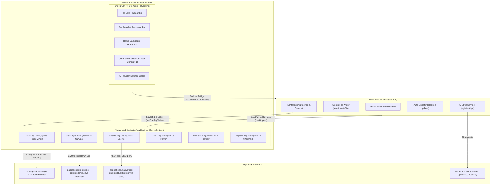
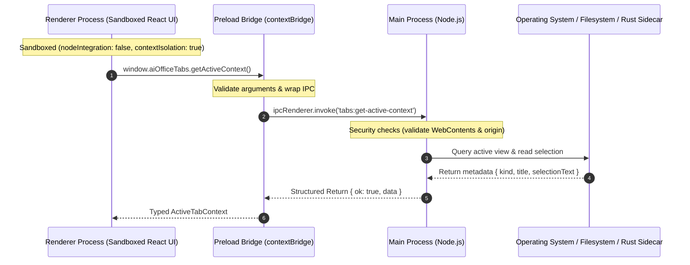
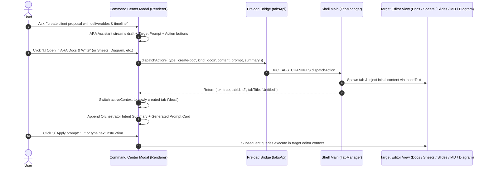
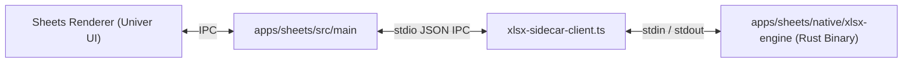

# ARAOffice Architecture & System Design Guide

This document provides a comprehensive technical guide to the architecture, process separation, inter-process communication (IPC), technology stack, and engineering invariants of **ARAOffice**. It is written for both human engineers and AI coding agents to understand the system deeply and maintain architectural integrity.

---

## Table of Contents

1. [System Philosophy & Core Invariants](#1-system-philosophy--core-invariants)
2. [High-Level System Architecture](#2-high-level-system-architecture)
3. [Technology Stack Matrix](#3-technology-stack-matrix)
4. [Process Model & Three-Layer Separation](#4-process-model--three-layer-separation)
5. [Cross-View Host & Tab Windowing](#5-cross-view-host--tab-windowing)
6. [Inter-Process Communication (IPC) Contracts](#6-inter-process-communication-ipc-contracts)
7. [Universal Command Center & Omnibar AI Architecture](#7-universal-command-center--omnibar-ai-architecture)
8. [Document Engines & File Fidelity](#8-document-engines--file-fidelity)
9. [Native Rust Sidecar (`xlsx-engine`)](#9-native-rust-sidecar-xlsx-engine)
10. [Agent Engineering Guidelines & Quality Gates](#10-agent-engineering-guidelines--quality-gates)

---

## 1. System Philosophy & Core Invariants

ARAOffice is an AI-native desktop office suite consisting of six editors (`docs`, `sheets`, `slides`, `pdf`, `markdown`, `diagram`), and a coordinating host application (`shell`).

### The Three Cardinal Invariants

1. **File-Format Fidelity (Zero Byte Drift)**:
   - When opening, editing, and saving standard office files (`.docx`, `.xlsx`, `.pptx`, `.pdf`), the system **must preserve** untouched styling, raw XML structures, relationships, and metadata.
   - **Never** reconstruct OOXML or ZIP archives from scratch.
   - **Never** drop unrecognized XML namespaces, shape presets, or drawing elements.
   - Use narrow, byte-anchored patches and minimal diffs.

2. **Strict Three-Layer Process Isolation**:
   - **Main Process (`src/main`)**: Node.js runtime with native OS, filesystem, and sidecar access. No DOM access.
   - **Preload Scripts (`src/preload`)**: Sandboxed, context-isolated bridge exposing strictly typed channels via `contextBridge.exposeInMainWorld()`.
   - **Renderer Process (`src/renderer`)**: Sandboxed React 19 UI bundled with Vite. **Never** access Node APIs, `electron`, or `fs` directly from renderers.

3. **Gated Protocol & AI Safety**:
   - External URL navigation is strictly allowlisted (`safeExternalUrl` allows `http:`, `https:`, and `mailto:` for user-activated document links — a dead mailto hyperlink in DOCX/PPTX is a fidelity break; `file:`, `javascript:`, and custom schemes are rejected).
   - AI layout generation executes through constrained AST interpreters (e.g. Acorn AST), never raw `eval`, `Function`, or VM scripts.
   - All AI prompts and context treats document content as untrusted data inside `<untrusted_context>` blocks.

---

## 2. High-Level System Architecture



---

## 3. Technology Stack Matrix

| Layer / Component        | Technology                                        | Role & Details                                                                                                         |
| :----------------------- | :------------------------------------------------ | :--------------------------------------------------------------------------------------------------------------------- |
| **Runtime & Shell**      | Electron 43, Node.js `>=22.12.0`                  | Desktop container, multi-tab windowing via `WebContentsView`.                                                          |
| **Monorepo Manager**     | npm workspaces (npm `>=10`)                       | Unified dependency resolution across `apps/*` and `packages/*`.                                                        |
| **UI Framework**         | React 19                                          | Declarative UI across Shell and all editor applications.                                                               |
| **Bundler & Dev Server** | Vite 7/8 + `electron-vite`                        | Fast HMR, ESM bundling, strict asset pipeline.                                                                         |
| **Styling**              | Vanilla CSS + Design Tokens                       | Shared theme tokens (`--surface`, `--accent`, `--border`), Dark/Light themes.                                          |
| **DOCX Editor**          | TipTap / ProseMirror                              | Paginated word processing with paragraph-level OOXML byte patcher.                                                     |
| **XLSX Editor**          | Univer + Rust Native Sidecar                      | High-performance canvas grid backed by Rust calculation engine.                                                        |
| **PPTX Editor**          | Konva Canvas + `@araoffice/pptx-render`           | Master/layout placeholder inheritance, EMU-to-pixel draw lists.                                                        |
| **PDF Editor**           | PDF.js + `pdf-lib`                                | Document rendering, annotation pipelines, vector manipulation.                                                         |
| **Markdown Editor**      | TipTap block editor / Live Preview                | Real-time Markdown parser, GFM extensions, export pipelines.                                                           |
| **Diagram Editor**       | maxGraph canvas (Draw.io-compatible) / Mermaid.js | Visual shape canvases and code-based Mermaid flowcharts.                                                               |
| **AI Agent Loop**        | `@araoffice/agent-core`                           | ReAct loop, `composeSkills`, shared prompts/tools (`shared-skills.ts`), `createIpcTransport`, `sanitizeModelIdentity`. |
| **AI Providers**         | `@araoffice/ai-provider`                          | Direct clients for Google AI Studio (Gemini) and any OpenAI-compatible endpoint; no proxy, no fallback chain.          |
| **Unit Testing**         | Vitest 4 (`jsdom` & `node`)                       | Unit tests per workspace with Canvas and Electron mocks.                                                               |
| **Native Rust Engine**   | Rust Edition 2024 + Cargo                         | Sidecar binary for XLSX calculation and streaming XML archives.                                                        |

---

## 4. Process Model & Three-Layer Separation

Each editor and the shell runs inside its own isolated process boundary:



### Process Isolation Rules

1. **Renderers** must only communicate through `window.desktopApi`, `window.aiOfficeTabs`, or `window.aiOfficeAi`.
2. **Preload scripts** must never expose raw `ipcRenderer` to the global `window` object. Every method is wrapped.
3. **Main process** handlers must validate arguments, sanitize file paths, and return `{ ok: boolean; data?: T; error?: string }` objects rather than throwing exceptions across the IPC boundary.

---

## 5. Cross-View Host & Tab Windowing

Unlike typical multi-tab Electron applications that use multiple windows or complex IFrames, ARAOffice uses native **`WebContentsView`** instances hosted inside a single `BrowserWindow`.

### View Bounds and Z-Ordering

- The shell `BrowserWindow` hosts the Tab Bar at `y: 0` to `y: 40px`.
- Active editor tabs (`docs`, `sheets`, `slides`, etc.) are attached as child views positioned at `y: 40px`, occupying `height: windowHeight - 40px`.
- **The Home Launcher** (`id: 'home'`) has no child view: hiding all child views reveals the shell window's own DOM.

```
+-------------------------------------------------------------+
| Shell Tab Strip: [Home] [Strategic_Plan.docx] [Model.xlsx]  | (y: 0 to 40px)
+-------------------------------------------------------------+
|                                                             |
|                                                             |
|                  Active WebContentsView                     |
|           (Docs / Sheets / Slides / PDF / MD)               | (y: 40px to bottom)
|                                                             |
|                                                             |
+-------------------------------------------------------------+
```

### The Modal Occlusion Challenge & Solution (`setOverlayVisible`)

Because native `WebContentsView` instances paint directly in the compositor on top of the shell DOM, any DOM dialog (such as the **Command Center**, **AI Provider Settings**, or **Feedback Modal**) would normally be covered by the active document below `y: 40px`.

- **Mechanism**:
  - `TabManager.setOverlayVisible(visible: boolean)` captures an ephemeral, downscaled JPEG snapshot (~80–120 KB) of the active editor view before toggling `active.view.setVisible(!visible)`.
  - When a shell modal opens, this snapshot is placed in the shell DOM directly behind the modal overlay. This allows the modal's `backdrop-filter: blur(...)` to seamlessly blur the document editor underneath without any visual blanking or black voids.
  - When the modal closes, the snapshot is cleared and the active view is restored instantly (`setVisible(true)`), ensuring zero latency, zero flicker, and zero loss of user progress.

---

## 6. Inter-Process Communication (IPC) Contracts

IPC channels are strictly partitioned by domain across the workspaces:

| Domain                 | Channels Defined In                 | Example Channels                                                                                                          | Handled In                                 |
| :--------------------- | :---------------------------------- | :------------------------------------------------------------------------------------------------------------------------ | :----------------------------------------- |
| **Tabs Management**    | `apps/shell/src/shared/tabs-api.ts` | `tabs:list`, `tabs:activate`, `tabs:close`, `tabs:set-overlay-visible`, `tabs:get-active-context`, `tabs:dispatch-action` | `apps/shell/src/main/tab-manager.ts`       |
| **Shell Home & Files** | `apps/shell/src/shared/home-api.ts` | `home:recents`, `home:starred`, `home:new-doc`, `home:new-sheet`, `home:browse`                                           | `apps/shell/src/main/index.ts`             |
| **AI Streaming**       | `apps/shell/src/shared/ai-api.ts`   | `ai:get-settings`, `ai:set-settings`, `ai:stream`, `ai:cancel`, `ai:stream-chunk`                                         | `apps/docs/src/main/docs-main.ts` (shared) |

| **Window Controls** | `apps/shell/src/shared/window-api.ts` | `window:minimize`, `window:toggle-maximize`, `window:is-maximized`, `window:close` | `apps/shell/src/main/index.ts` |

### Subscription Teardown Pattern

All IPC event subscriptions in preload bridges must return an explicit cleanup function for React `useEffect` hooks:

```ts
// Preload
onChanged(handler: (tabs: TabSummary[]) => void): () => void {
  const listener = (_event: IpcRendererEvent, tabs: TabSummary[]) => handler(tabs)
  ipcRenderer.on(TABS_CHANNELS.changed, listener)
  return () => ipcRenderer.removeListener(TABS_CHANNELS.changed, listener)
}

// React Component
useEffect(() => {
  const unsubscribe = window.aiOfficeTabs.onChanged(setTabs)
  return () => unsubscribe()
}, [])
```

---

## 7. Universal Command Center & Central Workspace Orchestrator

The Command Center (`Ctrl+K` / `⌘K`) serves as the central neural hub of ARAOffice, fusing Spotlight-style command navigation, tab switching, and recent file access with the **ARA Assistant Central Workspace Orchestrator & Target Editor Prompt Generator**.

### Orchestrator & Prompt Generator Data Flow



### Core Architecture Components

1. **Dual-Mode Ergonomic Interface**:
   - **Command Search Mode (`!isAiMode`)**: Spotlight-style top bar (`>_`) filtering commands grouped by function, open tabs, and recent documents.
   - **AI Conversation Mode (`isAiMode`)**: Dedicated top header (Back button, active document badge, `+ New Chat`, ESC), scrollable middle message thread, and a docked bottom chat input bar with auto-focus and instant `Enter` dispatch. Session threads persist across modal toggles (`Ctrl+K` / `ESC`) unless explicitly reset.

2. **Smart Target Application Detection (`detectTargetApp`)**:
   - Automatically classifies streamed AI output into the optimal editor application:
     - **Diagram**: Detects Mermaid syntax (````mermaid`,`graph`,`flowchart`,`sequenceDiagram`,`classDiagram`, etc.).
     - **Sheets**: Detects tables with numerical calculations, `SUM`, `AVERAGE`, financial models, or CSV structures.
     - **Slides**: Detects presentation slide decks, slide outlines, and visual card archetypes.
     - **Markdown**: Detects technical specifications, README outlines, and markdown code fences.
     - **Docs**: Default rich document format for proposals, reports, letters, and summaries.

3. **Direct Byte & Text Injection (`dispatchTabAction`)**:
   - Executes `dispatchTabAction({ type: 'create-doc', kind, content, prompt, summary })`.
   - Handles auto-mode configuration (e.g. automatically switching the Diagram editor into `mermaid` mode when Mermaid syntax is detected).
   - Injects clean text/code directly into the newly mounted view via `view.webContents.insertText()`, eliminating manual copy-pasting.

4. **Intent Continuity & Target Editor Prompt Generator**:

- Creates a dedicated **Workspace Orchestrator Card** in the conversation thread containing:
  - **User Intent Summary**: Retains context from the original conversation.
  - **Generated Target Editor Prompt**: Synthesizes a high-signal, tailored prompt for the editor's next steps (e.g. formula auditing in Sheets, node styling in Diagram, or section expansion in Docs).
  - **1-Click Execution Chips**: E.g. `⚡ Apply prompt: "..."`, which immediately fires the generated prompt against the new editor tab.

### Prompt Unification & Skill Routing

- **One shape per app:** `apps/<app>/src/renderer/ai/prompts/system.md` (domain-only) + `prompts/follow-ups.ts` (+ sheets `prompts/guides/`), wired by `<app>-skill.ts` as `create<App>Skill` (`id` = folder name, tools `<APP>_TOOLS`, executor `execute<App>Tool(deps, call)`, context `build<App>Context`). Shared `files` / `search` skills compose alongside via `composeSkills` (tool names stay globally unique).
- **One shared file:** `packages/agent-core/src/shared-skills.ts` (`buildAppSystemPrompt(section)` = identity + policy + section, `CONTINUE_INSTRUCTION`, `FILES_PROMPT`, `SEARCH_PROMPT`, `READ_ATTACHMENT_TOOL`, `WEB_SEARCH_TOOLS`, format helpers), re-exported from `@araoffice/agent-core`.
- **Assembly (single pipeline, 7 wirings):** `system = skill.systemPrompt + systemSuffix() + budgetNotice`; per-turn `skill.buildContext()` rides the user message, never the system prompt. Each `ai/transport.ts` is a thin `createIpcTransport` wrapper differing only by `app` + preload bridge + i18n error keys — no central router exists or is needed.
- **Canonical renames (legacy aliases kept for tests):** skill id `'docx'` → `'docs'`; `AGENT_TOOLS` → `<APP>_TOOLS` (docs/markdown/pdf/diagram/sheets; slides keeps its local `TOOLS` + figure-gate + QC inside `slides-skill.ts` on purpose); executors deps-first (`executeWorkbookTool(call, deps)` → `executeSheetsTool(deps, call)`, docs positional `executeTool` kept as alias); `<App>SkillDeps` deps bags (`DeckAccess` = `SlidesSkillDeps` alias). Sheets panel stays `AiChatPanel`; `aiLangDirective` stays per-app wrappers over shared `AI_LANG_DIRECTIVES` (shared takes `lang`, app wrappers read module lang).
- **Routing (omnibar):** chat (`getActiveContext` → `appGuidance[kind]` + `<untrusted_context>` → `aiOfficeAi.stream`, read-only, billing `home→docs`), generate (`synthesizeHandover`, 4s timeout → `fallbackHandover`), transport (`dispatchAction({type:'create-doc'})` → `TabKind` + `menu:command/ai-prompt` IPC → `setAiPreset`/`runWith` → AgentLoop). Tool names are model-facing contract — NEVER rename.

### AI Identity & Guardrails

- **Official Identity (`ARA_ASSISTANT_IDENTITY`)**:
  - Name: **ARA Assistant** — a static constant in `packages/agent-core/src/identity.ts` (`ARA_ASSISTANT_NAME` / `ARA_PRODUCT_NAME`). There is no build-time persona injection: the identity is the same in every build.
  - Persona: Comprehensive office intelligence across all 6 applications (Word `.docx`, Excel `.xlsx` with native Rust engine, PowerPoint `.pptx`, PDF `.pdf`, Markdown `.md`, and Diagram/Mermaid `.diagram`) plus general problem-solving, coding, and brainstorming.
- **Provider Separation**:
  - The persona and output scrubbing (`sanitizeModelIdentity`) are the same regardless of which provider serves the request. The provider only decides _which model_ answers.
  - **Gemini AI (`provider === 'google'`)**: the app calls the Google AI Studio REST API directly from the main process (`packages/ai-provider/src/google.ts`).
  - **OpenAI-Compatible (`provider === 'custom'`)**: the app calls any OpenAI-compatible `/chat/completions` endpoint directly (`packages/ai-provider/src/custom.ts`) — Ollama, LM Studio, OpenAI, or a relay.
- **Model Selection**:
  - Gemini models: `gemini-3.8-flash` (default), `gemini-3.5-flash-lite`, `gemini-3.1-pro`.
  - OpenAI-compatible models: free-form text, optionally discovered via `GET {baseUrl}/models` (`fetchCustomModels`).
  - The choice persists in `ai-settings.json`; `defaultAiSettings()` and every panel first-paint default resolve to Google with `gemini-3.8-flash`.
  - No fallback chain, no quota manager, no routing tier: the user configures one provider and the app calls it directly.
- **Runtime Scrubbing (`sanitizeModelIdentity`)**:
  - Applied to every stream to protect persona consistency.
- **Untrusted Context Quarantine**:
  - Document filenames, text selections, and user drafts are strictly quarantined inside `<untrusted_context>` tags. The model treats them as passive data, preventing prompt injection.
- **1-Click User Confirmation**:
  - The Omnibar never mutates documents silently. It renders formatted proposal cards with explicit 1-click execution buttons.

---

## 8. Document Engines & File Fidelity

### `docx-engine` (`packages/docx-engine`)

- **Block-Tree Document Model**: Parses OOXML into blocks (`p`, `tbl`, `drawing`).
- **Paragraph-Level Byte Patcher (`src/text-patch.ts`)**:
  - Verbatim preserves every byte of untouched paragraphs, tables, theme colors, and custom styles.
  - Modifying text updates only the targeted `<w:t>` nodes within that specific `<w:p>`.

### `pptx-engine` & `pptx-render` (`packages/pptx-*`)

- **Master & Layout Inheritance**: Resolves shapes, color palettes, and placeholders from Slide Master down to Layout, and down to Slide.
- **Data-Driven EMU-to-Pixel Draw List**: Compiles PPTX vector shapes, text frames, and table grids into normalized draw lists for Konva 2D rendering.
- **Byte Serialization**: Untouched slides retain their verbatim source XML.

### `electron-utils` (`packages/electron-utils`)

- **Atomic File Writing (`atomicWriteFile`)**:
  - Writes to a temporary `.tmp` file in the same directory and executes an atomic rename.
  - Uses exponential backoff (`renameWithRetry`) to withstand Windows file locking (`EBUSY`, `EPERM`) caused by antivirus or cloud sync agents.

---

## 9. Native Rust Sidecar (`xlsx-engine`)

For large spreadsheets, JavaScript engines face severe performance and memory limits. ARAOffice offloads heavy workbook calculations and archive streaming to a native Rust sidecar.



- **Location**: `apps/sheets/native/xlsx-engine` (Rust edition 2024).
- **Communication Protocol**: Newline-delimited JSON over `stdin` and `stdout`.
- **Capabilities**:
  - Fast formula parsing and dependency graph recalculation.
  - Streaming XLSX archive decompression and incremental row parsing.
  - Formula dependency evaluation (resolving circular references and array formulas).

---

## 10. Agent Engineering Guidelines & Quality Gates

When contributing code or modifying components in ARAOffice, every engineer and AI agent **must adhere** to the following rules:

### 1. File Modification Rules

- **No Semis, Single Quotes**: Prettier config mandates no semicolons, single quotes, 100 character width, and LF line endings.
- **Kebab-Case File Naming**: All files and directories use `kebab-case` (e.g. `omnibar-prompt.ts`, `tab-manager.ts`).
- **PascalCase Components**: React components use `PascalCase` (e.g. `CommandCenterModal.tsx`).

### 2. State & Process Rules

- **No Global Stores**: Do not introduce Redux, Zustand, or MobX. Keep state local (React `useState`, `useRef`, custom action modules). Document state belongs to the active editor engine.
- **Node-Pure Packages**: Code in `packages/*` must remain pure (no Electron imports or Node globals unless categorized under `packages/electron-utils`).

### 3. Pre-Commit Quality Gate

Before submitting any pull request or declaring a task complete, run:

```bash
npm run format:check && npm run lint && npm run typecheck && npm test
```

| Verification Check | Command                | Expectation                                                            |
| :----------------- | :--------------------- | :--------------------------------------------------------------------- |
| **Formatting**     | `npm run format:check` | All matched files use Prettier style.                                  |
| **Linting**        | `npm run lint`         | ESLint passes with 0 errors.                                           |
| **TypeScript**     | `npm run typecheck`    | `tsc --noEmit` passes with 0 errors across all workspaces.             |
| **Unit Tests**     | `npm test`             | All Vitest test suites pass (Shell, Docs, Sheets, Slides, Agent-Core). |
