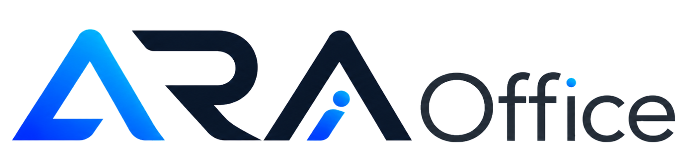
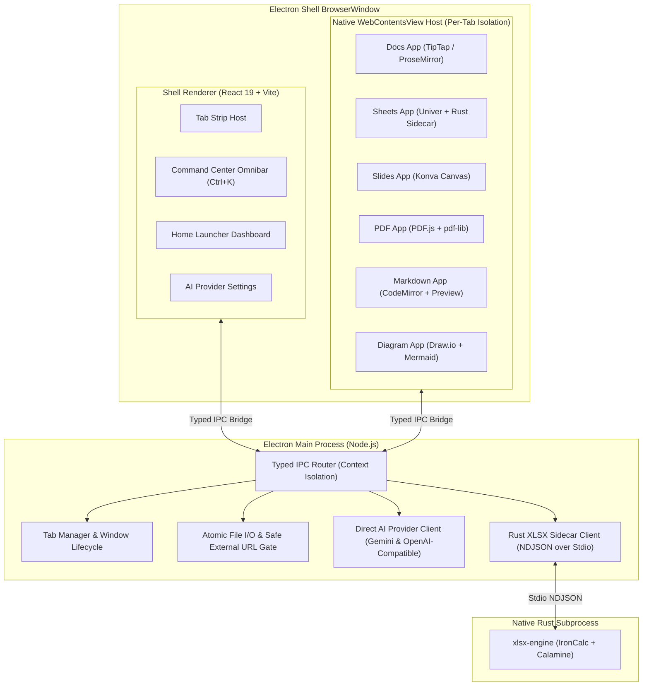

# ARAOffice

<p align="center">
  
</p>

<p align="center">
  <strong>Modern, Privacy-First AI-Native Desktop Office Suite with Integrated AI Copilot</strong>
</p>

<p align="center">
  <a href="#overview">Overview</a> •
  <a href="#key-features">Features</a> •
  <a href="#six-core-editors">Editors</a> •
  <a href="#ara-assistant-ai-copilot">AI Copilot</a> •
  <a href="#getting-started">Getting Started</a> •
  <a href="#architecture">Architecture</a> •
  <a href="#privacy--security">Privacy & Security</a> •
  <a href="#license">License</a>
</p>

---

## Overview

**ARAOffice** is an open-source, offline-first, AI-native desktop office suite designed as a fast, private, and capable alternative to Microsoft 365 and Google Workspace. Hosted in an Electron shell with context-isolated multi-tab windowing (`WebContentsView`), ARAOffice provides six full-featured editors (`docs`, `sheets`, `slides`, `pdf`, `markdown`, `diagram`) sharing a byte-preserving engine layer and unified by an optional, client-direct AI copilot (**ARA Assistant**).

ARAOffice is built on two uncompromised invariants:

1. **File-Format Fidelity**: Opening, modifying, and saving DOCX, XLSX, PPTX, or PDF files never rewrites untouched structures or corrupts unknown XML namespaces. Edits are applied via narrow, byte-anchored patches and minimal diffs.
2. **Zero Cloud, Zero Accounts**: The entire application launches and functions completely offline. There are no user sign-ins, no tracking beacons, no analytics, and no remote feedback services.

---

## Key Features

- **Strict File-Format Fidelity (Zero Byte Drift)**:
  - Paragraph-level byte patching for `.docx`.
  - In-house Rust calc and archive sidecar for `.xlsx` (IronCalc + Calamine).
  - Exact layout, master, and slide inheritance preservation for `.pptx`.
  - Non-destructive vector annotation, form-filling, and page reorganization for `.pdf`.
- **Universal Multi-Tab Shell**:
  - Unified desktop launcher (`apps/shell`) with smooth multi-tab management, recent files, and custom native window controls.
  - Universal Command Center Omnibar (`Ctrl+K` / `⌘K`) for global navigation, smart intent routing, and cross-app artifact creation.
- **Client-Direct AI Copilot (ARA Assistant)**:
  - Directly connect to your preferred endpoint: **Google Gemini** (Google AI Studio) or any **OpenAI-compatible** endpoint (local **Ollama**, **LM Studio**, vLLM, or cloud OpenAI).
  - Credentials remain strictly local in your machine's `ai-settings.json` and are never broadcast or logged.
- **100% Offline-First & Private**:
  - Full productivity without an active Internet connection.
  - Zero telemetry, zero telemetry packages, and zero third-party phone-home requests.

---

## Six Core Editors

| App             | Product               | Capabilities & Technology                                                                                                                                                                                                             |
| :-------------- | :-------------------- | :------------------------------------------------------------------------------------------------------------------------------------------------------------------------------------------------------------------------------------ |
| `apps/docs`     | **ARAOffice Docs**    | Word processor for `.docx`. TipTap/ProseMirror engine with UAX#14 line breaking, real font metrics pagination, comments, tracked changes, and paragraph-level byte patching that guarantees untouched content remains byte-identical. |
| `apps/sheets`   | **ARAOffice Sheets**  | High-performance spreadsheet for `.xlsx`. Univer core with in-house formula engine, pivot tables, charts (Konva), conditional formatting, and streaming archive parsing powered by an in-house Rust sidecar.                          |
| `apps/slides`   | **ARAOffice Slides**  | Presentation editor for `.pptx`. In-house OOXML model with layout inheritance, HarfBuzz text shaping, visual archetypes (process flows, timelines, checklists, KPIs), and speaker notes.                                              |
| `apps/pdf`      | **ARAOffice PDF**     | PDF document toolkit based on PDF.js and `pdf-lib`. Annotations, signatures, form filling, page reordering/merging/splitting, image extraction, and accessibility validation.                                                         |
| `apps/markdown` | **ARAOffice Notes**   | Technical markdown editor with live side-by-side preview, GFM tables, syntax-highlighted code fences, outline tree, and DOCX/HTML export pipelines.                                                                                   |
| `apps/diagram`  | **ARAOffice Diagram** | Dual-engine visual diagramming tool supporting interactive Draw.io canvases and live Mermaid.js code rendering with automatic layout generation.                                                                                      |

---

## ARA Assistant (AI Copilot)

ARAOffice embeds **ARA Assistant**, an intelligent copilot designed to work alongside your documents rather than replace human control:

- **Universal Omnibar Orchestrator (`Ctrl+K` / `⌘K`)**:
  - Formulate goals in natural language. ARA Assistant drafts structured proposals, formulas, slide decks, or architecture diagrams.
  - **1-Click Handover**: Transfer drafts directly into the target editor (`Open in Docs & Write`, `Open in Sheets & Write`, `Open in Diagram & Write`).
- **Context-Aware In-Editor Assistance**:
  - Every editor includes a dedicated AI sidebar panel.
  - **Docs**: Block-granular text transformations, style harmonization, summaries, and translations with interactive diff review.
  - **Sheets**: Natural language formula generation, cell transformations, data cleaning, and statistical summaries via a structured workbook DSL.
  - **Slides**: Automated presentation outlining, slide layout generation, and archetype formatting.
  - **PDF & Notes**: Document Q&A, key takeaway extraction, citation structuring, and technical drafting.
- **Direct-Connect Architecture**:
  - The Electron main process initiates direct HTTPS/HTTP requests to your configured AI provider. No intermediary servers, no proxies, and no prompt data logging.
  - Compatible with local inference servers: run local models offline with **Ollama** (`http://localhost:11434/v1`) or **LM Studio** (`http://localhost:1234/v1`).

---

## Getting Started

### Prerequisites

- **Node.js**: `>= 22.12.0` (tested on Node 22 LTS)
- **npm**: `>= 10`
- **Rust Toolchain**: `cargo` on PATH (required for compiling the Sheets `xlsx-engine` sidecar)

### 1. Clone & Install Dependencies

```bash
git clone https://github.com/funara/araoffice.git
cd araoffice
npm install
```

### 2. Development Commands

```bash
# Start all six editors and the host shell in dev mode with HMR
npm run dev

# Or launch an isolated editor for focused frontend development
npm run dev:docs        # Docs editor (:5173)
npm run dev:sheets      # Sheets editor (:5174)
npm run dev:slides      # Slides editor (:5175)
npm run dev:pdf         # PDF editor (:5176)
npm run dev:markdown    # Markdown editor (:5177)
npm run dev:diagram     # Diagram editor (:5178)
npm run dev:docs-shell  # Docs + Shell combo (:5199)
```

### 3. Quality & Verification Gates

```bash
# Check incremental code formatting with Prettier
npm run format:check

# Run flat ESLint across all workspaces (0 errors required)
npm run lint

# TypeScript verification across all 18 workspaces
npm run typecheck

# Execute Vitest test suite across all engines and editors
npm test

# Verify production dependencies against license allowlist
npm run licenses

# Run personal privacy spill detection gate
npm run spill
```

### 4. Building & Packaging

```bash
# Build production bundles for all apps into out/
npm run build:all

# Run the packaged shell locally
npm run shell

# Generate platform-specific desktop installers
npm run dist:win      # Windows x64 NSIS installer
npm run dist:mac      # macOS DMG and ZIP
npm run dist:linux    # Linux AppImage
```

---

## Architecture

ARAOffice enforces strict process isolation and modular separation:



### Process Isolation Rules

- **Main Process (`src/main`)**: Node.js only. Handles window lifecycles, file I/O, local secrets storage, updater, and external AI network requests. No DOM access.
- **Preload Scripts (`src/preload`)**: Minimal context-isolated bridges via `contextBridge.exposeInMainWorld()`. Never exposes raw `ipcRenderer`.
- **Renderer Processes (`src/renderer`)**: Sandboxed React 19 apps running with `nodeIntegration: false, contextIsolation: true, sandbox: true`.

---

## Privacy & Security

- **100% Offline by Default**: ARAOffice performs zero network operations upon launch. Your documents, recent files history, and editor configurations never leave your machine.
- **Zero Telemetry**: ARAOffice does not contain any analytics SDKs, crash reporters, user tracking identifiers, or ping services.
- **Safe Protocol Gate**: All external link clicks pass through `safeExternalUrl` allowlisting only standard `http:`, `https:`, and `mailto:` protocols; unsafe protocols (`file:`, `javascript:`, shell commands) are strictly blocked.
- **Constrained AI AST Execution**: Dynamic slide layout scripts are parsed with Acorn and executed by a restricted AST interpreter—never passed to `eval()` or `Function()`.

### Third-Party AI & Zero Data Retention (ZDR) Disclaimer

ARAOffice is an **offline-first, privacy-first** application. All document parsing, rendering, byte-patching, and calculations execute entirely on your local workstation.

However, ARAOffice includes an optional **AI Copilot (ARA Assistant)** feature that allows you to connect external language model providers (e.g., Google Gemini, OpenAI-compatible APIs, or cloud proxies).

> [!WARNING]
> **User Responsibility & Consent Regarding Non-ZDR AI Endpoints:**
>
> 1. **Direct Connection**: When you configure and prompt an external cloud AI service, excerpts of your documents and prompts are transmitted directly from your computer to that third-party provider under your own API credentials.
> 2. **Zero Data Retention (ZDR)**: If you connect to an external provider that does **not** enforce a Zero Data Retention (ZDR) policy or an enterprise business agreement, your data may be logged, retained, or processed according to that third party's terms of service and training policies.
> 3. **Disclaimer of Liability**: ARAOffice and its author (**Adhi Rahmadian**) are **not responsible** for how third-party AI providers collect, retain, store, or utilize data transmitted through user-configured endpoints. The user assumes sole responsibility for selecting and vetting AI providers to ensure compliance with their institutional, regulatory, and privacy requirements.
> 4. **100% Offline AI Alternative**: If you work with sensitive, confidential, or proprietary documents and require guaranteed Zero Data Retention, you should exclusively use **local offline engines** (such as **Ollama** or **LM Studio**) communicating over loopback (`localhost`).

---

## Author & Creator

Created and maintained by **[Adhi Rahmadian](https://adhirahmadian.id)**.

---

## License

ARAOffice is free and open-source software licensed under the **[GNU General Public License v3.0 or later (GPL-3.0-or-later)](LICENSE)**.

Copyright (C) 2026 **Adhi Rahmadian** ([https://adhirahmadian.id](https://adhirahmadian.id)).
